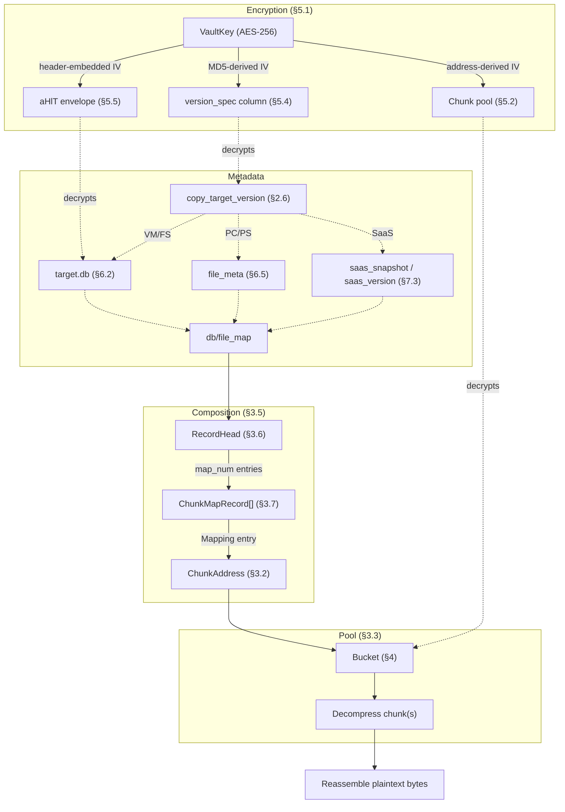

# FORMAT-SPEC

## §1. Scope & conventions

This document specifies the on-disk dedup backup repository format Synology
ActiveProtect writes when a backup is copied to an APV (ActiveProtect Vault)
or Object Storage (S3/Azure) destination: everything needed to open a
landed repository copy and recover a backed-up file's plaintext content
offline. It describes the bytes only; how a reader or this workspace's SDK
uses them is in the code.

A byte range `[a, b)` is half-open, inclusive of `a`, exclusive of `b`;
every multi-byte integer field is big-endian.

Terms:

- **Vault (APV)**: a destination on a filesystem (a local disk, or a share
  reached over SMB), laid out as §2.1 describes.
- **Object storage**: an S3 or Azure destination; it differs from a Vault
  in naming and generation selection (§2.1, §2.4) and key custody (§5.3).
- **Copy**: the job that lands backup versions from a source appliance in a
  destination repository. **Tiering** is another job writing into the same
  format; it differs only where noted (§7.3). **Landed**: written to the
  destination by such a job.
- **Connection**: an originating appliance connection the repository
  received data from (§2.3).
- **Workload**: one protected source: a VM, a PC, a physical server (PS), a
  file server (FS), or a SaaS user, site, group or team (§2.6). A
  **version** is one backup of a workload.
- **Stream, session, record, bucket, chunk**: the dedup layer's units,
  defined in §3 and §4.

## Overview

The main path from a workload's version to its bytes on disk (key
waypoints only; §6/§7 cover each workload's listing, §8 walks the chain
step by step):



---

## §2. Repository layout & versioning

### §2.1 Locating the repository root, and directory layout

- **Vault** (APV, or any local-filesystem Copy destination): a directory
  one level under the admin-chosen shared folder (conventionally
  `@ActiveProtectVault`; the name is not load-bearing) *is* the repository
  root. It is recognized by `repo_info`, `link.key` and `.fully_created`
  coexisting there (`link.key` is only checked for existence). One
  repository per root, one vault per shared folder.
- **Object storage** (S3/Azure landed copies): a root holding
  `@ActiveProtectData/<12-char-repo-id>/` directories and, beside
  `@ActiveProtectData`, an `@ActiveProtectKey/{userKey,link}/` tree
  (§2.3, §5.3). Each `<repo-id>` that has both `db/` and `@data/` is an
  independent repository; all of them share the key tree. (`repo_info` is
  not a usable marker here: it may exist only as `repo_info.<N>`.)

Once the root (`<repoRoot>`) is identified, it has this top-level shape:

```
<repoRoot>/
├── repo_info                  # §2.5 (suffixed .<N> on S3/Azure, §2.4)
├── db/
│   ├── file_map               # §2.2
│   ├── vault_link_key         # Vault only — §2.3
│   ├── workload_config, copy_target_version   # §2.6
│   └── ...                    # other SQLite databases (connection config, copy tracking, ...)
├── copy_meta_file/            # PC/PS/VM/FS version file-listing metadata — §6
├── saas/                      # SaaS workload account-level metadata — §7.3
├── repo_transactions/, suppl_transaction_ids/   # S3/Azure only — §2.4
├── .fully_created             # repository-creation-complete marker
└── @data/
    ├── Pool/                  # bucket files (.buk) and group sidecars (.inf/.fgp/.ref) — §3.3, §4
    ├── Composition/           # composition sessions (.com directories, c<N> sub-files) — §3.5
    └── repo_transaction       # Vault only; overwritten in place, never suffixed; not needed for reading
```

"Bucket" means two unrelated things in this document: an S3/Azure storage
container (as above) and a dedup-pool `.buk` data file addressed by
`bucketID` (§3.2 onward). Context tells which.

### §2.2 `db/file_map`

A SQLite database (no file extension) holding one table, keyed by path,
that is the entry point for locating any file's content:

| Column | Type | Notes |
|---|---|---|
| `path` | TEXT, primary key | One row per path: its current location only (§3.9). |
| `crtime`, `mtime` | — | Not needed to read content. |
| `stream_id`, `session_id`, `comp_offset` | — | The addressing triple — §3.9. |
| `block` | — | Chunk count covering this file; not needed to read content. |
| `status` | INTEGER | `0`=Initialized, `1`=Written, `2`=Complete, `3`=Compacted, `4`=Corrupted, `5`=Tainted. Only a `Complete` row is fully readable. |

A unique index covers `(stream_id, session_id, comp_offset)`.

### §2.3 `vault_link_key` / connection naming

Every connection (an originating APM connection this repository received
Copy data from) has a display name, landed as:

- **Vault**: `db/vault_link_key`, a SQLite table with one column, `key`,
  one row per link name.
- **Object storage**: the entry *names* of `@ActiveProtectKey/link/`
  (sibling of `userKey/`, §5.3); list the directory, don't read the files.

Each name has the form `"<connection_id>_<discarded>_<name...>"`. Find the
one whose `<connection_id>` matches, split on the first two `_` (the name
may contain more) and keep the third segment. A connection with no match
is shown by its raw id.

### §2.4 Multi-generation selection (S3/Azure destinations)

On S3/Azure, `repo_info` and every `db/<name>` are replaced by numbered
variants `<name>.<N>`, but the largest-suffix rule of §3.4 does **not**
apply: old generations are not cleaned up, and a generation can be
uploaded before the transaction referencing it commits. Selection uses two
directories at the repository root, `repo_transactions/` and
`suppl_transaction_ids/`:

1. **Latest committed transaction id**: open the largest-suffixed
   `repo_transactions/repo_transaction.<N>` (magic `rPTs`, same header and
   JSON-payload fields as §2.5) and read its `transaction_id` field — a
   JSON integer or decimal string, always `>=` the filename's `<N>`, which
   is not used.
2. **`repo_info` and every non-supplemental `db/<name>`** (including
   `file_map`): take the largest `.<N>` *strictly less than* that id. A
   suffix equal or greater is not (or not yet) committed.
3. **The nine supplemental tables** — `agent_connection`,
   `connection_config`, `copy_file`, `copy_source_version`,
   `copy_target_version`, `copy_target_version_meta`, `copy_target_file`,
   `file_meta`, `workload_config`: take the largest `.<N>` that has a
   matching empty marker object `suppl_transaction_ids/<N>`. This numbering
   is unrelated to the transaction log.

`copy_target_file` has no object of its own: its rows live in the same
SQLite file as `copy_target_version` and share its generation.

A bare `<name>` is used only when no `.<N>` variant exists. Otherwise it is
ignored, and if no suffix qualifies under the rule above, the database is
not found.

### §2.5 `repo_info`

A 64-byte header (magic `RpiF`) plus a JSON payload. Opening a repository
reads and validates it first (magic, header CRC32, JSON CRC and parse); a
missing or corrupt `repo_info` fails the open. Within the header's
format-specific region (§3.1):

| Offset | Size | Field |
|---|---|---|
| 8 | 4 | `json_crc` — CRC32 of the JSON payload |
| 12 | 8 | `data_size` — byte length of the JSON payload |
| 20 | 16 | `uuid` — the repository UUID, ASCII (display only) |
| 36 | 24 | *(unused)* |

### §2.6 `workload_config` & `copy_target_version`: catalog metadata schema

These two `db/` tables carry the JSON that classifies a workload and
lists its versions.

**`target_type` / `sub_type`.** `workload_config.workload_type` and
`copy_target_version.target_type` are one of `VM`, `PC`, `PS`, `FS`
(device workloads) or `GW` (Google Workspace, written GWS elsewhere),
`M365` (SaaS connectors). A SaaS workload's application is
`workload_spec.spec.workload_type`, one of `MAIL`, `CONTACT`, `CALENDAR`,
`DRIVE`, `USER_DRIVE`, `SITE`, `USER_EXCHANGE`, `TEAMS`, `USER_CHAT`,
`TEAM_DRIVE`, `GROUP_EXCHANGE`. Each is one application service except
`USER_EXCHANGE` (Mail + archive Mail + Contact + Calendar) and
`GROUP_EXCHANGE` (Mail + Contact + Calendar), which bundle several
independently populated services in one version (§7.3). `TEAM_DRIVE` and
`GROUP_EXCHANGE` are the shared counterparts of `USER_DRIVE` and
`USER_EXCHANGE` with the same schema; GWS has no `GROUP_EXCHANGE`.

**`workload_config.workload_spec`** (JSON): a top-level `namespace`
(server-internal bookkeeping id) plus a nested `spec`:

| Field | Present for | Meaning |
|---|---|---|
| `spec.workload_name` | device workloads | The name driving display-name derivation. |
| `spec.config_vm.os_name` / `.hypervisor_name` | VM | Subtitle detail. |
| `spec.config_fs.os_name` | FS | Subtitle detail. |
| `spec.workload_type` | SaaS | The `sub_type` above. |
| `spec.tenant_id` | M365 | The M365 tenant GUID (M365 carries no plain domain anywhere). |
| `spec.domain` | GW | The GWS domain. |

A SaaS workload's display name (its user/site/group/team) comes from
`workload_spec.status.entity_meta.spec`, holding exactly one of
`user_info` (`{name, email}`), `site_info` (`{site_name}`), `group_info`
(`{display_name, mail}`), `team_drive_info` (`{name}`) or `team_info`
(`{name}`).

**`copy_target_version.version_spec`** (JSON, encrypted per §5.4 when the
repository is encrypted) carries a `status` object:

| Field | Meaning |
|---|---|
| `status.status` | `COMPLETED`/`PARTIAL`/`CANCELED` mean the version has landed data worth listing (a canceled job may have transferred data before stopping); every other value (`BACKING_UP`/`FAILED`/`PAUSED`/`DELETING`/`DELETE_FAILED`/`CLONING`/`CMS_PROCESSING`/`NONE`) means nothing landed. |
| `status.start_time` / `end_time` | Epoch seconds as a protobuf-JSON **string** (e.g. `"1786024626"`); `"0"`/`0` means unset, not 1970. When `start_time` is unset, `end_time` is the version's time. |
| `status.additional_meta` | A **JSON string** (double-encoded) holding the version's object-name index (see below). |

A non-zero `copy_target_version.deleted` marks a version as deleted.

**`status.additional_meta`**, once parsed, holds `object_db_id` (a
`"<streamUuid>_<offset>_<length>"` address, §7.3) and
`db_object_ids.db_objects`, an array of `{name, object_id}` pairs naming
the object in the version's `saas_obj` stream that holds each service
database. It is the only index of a SaaS version's service databases;
without it they are found only by §7.3's offline reconstruction.

---

## §3. Addressing: ChunkAddress → Composition → ChunkMapRecord → file_map

### §3.1 The generic 64-byte header shell

Every binary format here opens with the same 64-byte header:

| Offset | Size | Field |
|---|---|---|
| 0 | 4 | magic (ASCII) |
| 4 | 2 | major version |
| 6 | 2 | minor version |
| 8 | 52 | format-specific payload |
| 60 | 4 | header CRC32 over `[0,60)` |

The minor version carries no meaning for reading. The major version
matters only where noted: `.buk` is at most 3 (§4.1) and composition is
exactly 1 (§3.5).

| Magic | Format |
|---|---|
| `bFiL` | Bucket data file (`.buk`) — §4 |
| `GMet` | Bucket-group info file (`.inf`) — §4.5 |
| `bRfC` | Bucket-group refcount file (`.ref`) — not needed for reading |
| `RpiF` | `repo_info` — §2.5 |
| `rPTs` | `repo_transaction` — §2.4 |
| `cMpS` | Composition sub-file header — §3.5 |
| `aHlT` | `copy_meta_file` encryption envelope — §5.5 |
| `lINk` | `link.key` — only checked for existence (§2.1) |

`.fgp` fingerprint files (§4.5) have no header.

### §3.2 `ChunkAddress`

A single 64-bit value packing three fields:

```
bit  63........56  55..................16  15........0
    | streamID(8) |     bucketID(40)      | chunkIdx(16) |
```

- `streamID`: which dedup stream (a small integer, unrelated to any
  workload UUID).
- `bucketID`: which bucket file in that stream's Pool.
- `chunkIdx`: the chunk slot within the bucket. A bucket holds at most
  2¹³ = 8192 chunks, well under the field width.

Advancing a `ChunkAddress` by `k` chunks (to expand a chunk-map run,
§3.7) carries into `bucketID` at the 8192-chunk boundary, not at the
16-bit field boundary; adding `k` to the raw 64-bit value is wrong.

Every chunk is 4096 bytes of *plaintext*, the format's fixed chunking
granularity.

### §3.3 Derived addresses & Pool path layering

A `GroupID` is the address of a 1024-bucket group: a bucket id with its
low 10 bits cleared. The group sidecars `.inf`, `.fgp` and `.ref` (§4.5)
are written per group and use the bucket path scheme with the group's
first bucket id.

A path is built from the numeric id by right-shifting by 10 bits
repeatedly to produce ancestor directory names until the value is 0, so
nesting grows only with the id (a stream with under 1024 buckets has no
extra nesting). The leaf is always the full decimal id:

```
Pool/<streamID>/[<id>>>30/][<id>>>20/][<id>>>10/]<bucketID>.buk
```

Composition paths (§3.5) apply the same layering to `sessionID` and
`subID`.

### §3.4 Sequence-id suffix mechanism

A file with one current generation — a bucket file, a composition
sub-file, a group's `.inf`/`.fgp`, and on Vault destinations `repo_info`
and `db/<name>` — may land with its logical name (`<bucketID>.buk`,
`c<subID>`, ...) suffixed by `.` and a decimal number (e.g.
`1234.buk.7`). Among the files whose name, after removing one trailing
`.<digits>`, equals the logical name, take the one with the largest
suffix; an unsuffixed file is valid and is picked when nothing else is
present. This holds on local-filesystem and object-storage destinations
alike, except `repo_info` and `db/<name>` on S3/Azure, which use §2.4.
`db/vault_encryption_key` (§5.3) is never suffixed.

Bucket files always carry a suffix on local-filesystem destinations;
composition sub-files do so there only when the repository has WORM
protection enabled.

### §3.5 Composition file splitting

A dedup stream's content is written across composition files addressed
by three levels:

- **`streamID`** (8-bit): the stream, matching the `streamID` in every
  `ChunkAddress` written under it.
- **`sessionID`** (64-bit): one contiguous write session, in practice one
  backup version's writing.
- **`subID`** (64-bit): the session's logical byte-offset space is split
  into fixed **16 MiB** sub-files.

```
Composition/<streamID>/[sessID layers.../]<sessionID>.com/[subID layers.../]c<subID>
```

with the §3.3 layering applied independently to `sessionID` and `subID`.
A session offset splits into sub-file coordinates as

```
sub_id                = global_offset >> 24
offset_within_subfile = global_offset & (16MiB - 1)
```

and a read crossing a 16 MiB boundary continues in the next sub-file.

Sub-file 0 starts with a 64-byte header, magic `cMpS`, major version 1,
with `subFileSize` (u32 at offset 8) equal to 16 MiB. The header is part
of the session's offset space, so no record starts below offset 64.

### §3.6 `RecordHead`: one backup version's record

One backup version of a file is a 32-byte record header at session offset
`headOff`, which is `db/file_map`'s `comp_offset` (§3.9):

| Offset | Size | Field | Notes |
|---|---|---|---|
| 0 | 2 | magic | ASCII `"Mu"` |
| 2 | 2 | status | `0`=Complete, `1`=Interrupted; any other value is corruption. A record reached via `file_map` is Complete in practice. |
| 4 | 2 | *(unused)* | — |
| 6 | 8 | `map_num` | Number of 20-byte `ChunkMapRecord` entries that follow. |
| 14 | 4 | `map_crc` | CRC32 of the whole `ChunkMapRecord` array. |
| 18 | 2 | `mode` | Bit `0x0001`: the trailer includes a Redundancy blob. Every current writer sets it; a record without it uses an older, unsupported layout. |
| 20 | 4 | `attr_leng` | Byte length of a JSON attribute blob after the chunk-map array (not needed to read content). |
| 24 | 4 | `attr_crc` | CRC32 of that blob (not needed to read content). |
| 28 | 4 | `head_crc` | CRC32 of bytes `[0,28)`; checked on every open. |

`RecordHead` is written last, after the array, the attributes and the
trailer, so a record a committed `file_map` row reaches always has a valid
header, and a crash mid-write leaves no `"Mu"` magic behind.

Records are packed back to back; one record's total length (and thus the
next `headOff`) is

```
32 + map_num*20 + attr_leng + redundancy_size(map_num*20, coverage=8192)
```

with `redundancy_size` as in §4.4. The trailer's Redundancy blob protects
the chunk-map array: when `map_crc` does not match, the array can be
repaired from it.

### §3.7 `ChunkMapRecord`: 20 bytes describing one segment

After a `RecordHead`, `map_num` 20-byte entries describe the file's
content. Each starts with a big-endian 64-bit word at `[0,8)`:

- Bits 59–56 (the low 4 bits of byte 0) are the **type**: `0` = Mapping,
  `1` = Zero; any other value is corruption. Bits 63–61 are always zero.
- Bit 60 (`0x10` of byte 0) is **INHERIT**: "unchanged from a reference
  version, pointing at the same stored chunks"; a reader may ignore it
  (§3.8).
- The low 56 bits are `fileChunkIdx`: the entry's file offset in chunks
  (`file_offset = fileChunkIdx << 12`).

The remaining 12 bytes depend on the type:

- **Mapping**: `[8,16)` is the base `ChunkAddress` (§3.2). `[16,20)` packs
  `map_num_field(16b) << 16 | repeat(16b)`: a template of `map_num_field`
  consecutive chunks from the base address, repeated `1 + repeat` times
  in the file — each repetition advances the file offset but restarts at
  the base address. Length = `map_num_field * (1 + repeat) * 4096`.
- **Zero**: `[8,16)` is unused. `[16,20)` is one 32-bit chunk count. The
  range is all-zero and uses no Pool storage. Length =
  `chunk_count * 4096`.

An entry of length 0 describes nothing and is skipped.

### §3.8 Hole vs. Zero vs. INHERIT

Entries are ordered by file offset but may leave gaps: before the first,
between two, or after the last. A gap is a **Hole** — sparse, unwritten
space that reads as zeros like a Zero entry but has no entry of its own.

A record does not store the file's exact byte length; the reader takes it
from the workload metadata (`file_meta.file_size`, §6–§7), treats any
range past the last entry up to that length as a Hole, and truncates the
final chunk to it.

Each version's array describes that version's whole content: INHERIT or
not, every byte is covered by its own Mapping entries, Zero entries and
Holes, and no earlier version's record is ever consulted.

### §3.9 The `file_map` relationship

A `db/file_map` row's `(stream_id, session_id, comp_offset)` (§2.2)
locates one version's `RecordHead` (§3.6): `stream_id`/`session_id` name
the composition session (§3.5) and `comp_offset` is the record's
`headOff` in it. The row is overwritten in place on every new backup
version of the path, so `file_map` holds the current state only; an older
version's record stays readable through its own triple until garbage
collection reclaims it.

---

## §4. Bucket (`.buk`) file format

### §4.1 Header & mode bits

A bucket file opens with the 64-byte header shell (§3.1), magic `bFiL`,
major version ≤ 3 (current writers use 3). Its `mode` is unrelated to
`RecordHead.mode` (§3.6).

| Offset | Size | Field |
|---|---|---|
| 8 | 4 | `mode` (bitset) — see below |
| 12 | 4 | `chunk_num` — number of chunk slots in this bucket |
| 16 | 4 | `chunk_size_crc` — CRC32 of the tightly-packed SizeStore bytes (§4.3) |
| 20 | 9 | *(unused)* |
| 29 | 4 | `crcOfChunkCrc` — CRC32 of the ChunkCrcStore bytes (§4.4) |
| 33 | 27 | *(unused)* |

`mode` bits:

| Bit | Meaning |
|---|---|
| `0x01` | COMPRESS — the compressed physical layout is in use (§4.2). |
| `0x02` | CHUNK_CRC — a per-chunk ciphertext CRC32 trailer is present (§4.4). |
| `0x80` | **VAULT_ENCRYPT** — this bucket's chunks are AES-256-CTR-encrypted with the VaultKey (§5.2). |

The other bits are reserved by the writer: `0x04` bucket-level parity,
`0x08` an alternate, non-VaultKey encryption scheme, `0x10`
locality-aware placement, `0x20` extent-level parity, `0x40` in-place
parity. None is set in practice, and none carries meaning for reading: in
practice `mode` is always `0x03` (unencrypted) or `0x83` (encrypted).

The mode bit is the authority for any one bucket; whether the repository
as a whole is encrypted comes from its key record (§5.3).

### §4.2 Physical layout

Every bucket uses the *compressed* layout (COMPRESS is always set):

```
[0,      64)     64-byte header
[64,   16384)    SizeStore (§4.3), tightly packed, zero-padded to fill this space
[16384, 16384+T) chunk data, tightly packed (T = sum of every chunk's effective length)
[16384+T, ...)   ChunkCrcStore (§4.4), then a Redundancy blob covering the SizeStore (coverage 256)
```

An older uncompressed layout (fixed 4096 bytes per chunk from offset 4096)
is read-compatibility-only; no current writer produces it.

### §4.3 SizeStore

One 15-bit entry per chunk, `type(3 bits) | size(12 bits)`, packed
big-endian with no alignment between entries. The tight length is
`ceil(chunk_num * 15 / 8)` bytes, and this (not the full 16320-byte
region) is what `chunk_size_crc` covers.

| Value | Name | Stored bytes | Effective length |
|---|---|---|---|
| 0 | None | plaintext | 4096 (the `size` field is ignored) |
| 1 | LZ4 | a raw LZ4 *block* (no frame, no size prefix) | `size` |
| 2 | ZSTD | one standard zstd frame | `size` |
| 4 | Compacted | nothing — reclaimed by compaction, unrecoverable | 0 |

Value 3 is unassigned and, like any other value, is corruption. A chunk must
decompress to exactly 4096 bytes. A chunk's byte range is `16384` plus the
sum of every earlier chunk's effective length. The codec is chosen per
chunk, so one bucket can mix LZ4 and ZSTD chunks; always read it from the
chunk's own entry.

### §4.4 ChunkCrcStore & Redundancy

The trailer begins with the ChunkCrcStore: one big-endian CRC32 per
non-empty chunk (effective length > 0, §4.3; a Compacted chunk is empty),
in chunk order, computed over the chunk's stored (compressed, encrypted)
bytes. The header's `crcOfChunkCrc` covers these `4 × non_empty` bytes
only. Reading content needs neither CRC.

A Redundancy blob follows and runs to the end of the file:

| Offset | Size | Field |
|---|---|---|
| 0 | 2 | magic `"RD"` |
| 2 | 2 | version (0) |
| 4 | 4 | `coverage` — window size |
| 8 | 8 | `data_size` — length of the protected bytes |
| 16 | `4 × ceil(data_size / coverage)` | `step_crc[i]` = CRC32 of `data[0, min((i+1)·coverage, data_size))` (cumulative) |
| … | `min(data_size, 2·coverage)` | parity: the XOR of the even windows, then the XOR of the odd windows |

Its size is `16 + 4·ceil(data_size/coverage) + min(data_size, 2·coverage)`.
It can locate and repair one damaged region spanning at most two adjacent
windows. A bucket's blob protects the SizeStore's tight bytes with
coverage 256; when `chunk_size_crc` does not match, the SizeStore can be
repaired from the file's last `redundancy_size(tight, 256)` bytes. A
bucket's exact size is therefore

```
16384 + T + 4·non_empty + redundancy_size(ceil(chunk_num·15/8), 256)
```

### §4.5 Sidecar files: `.inf`, `.fgp`

Each 1024-bucket group (§3.3) has:

- **`.inf`** (magic `GMet`, a multiple of 4096 bytes long): its allocation table at `[12288, 20480)`
  holds one 8-byte entry per bucket of the group. The first 4 bytes pack
  `offset4K(17 bits) | recNum(15 bits)`; the rest is unused. `offset4K ×
  4096` is the byte offset of the bucket's first fingerprint in the
  group's `.fgp` data, and `recNum` is how many fingerprints it has.
- **`.fgp`** (no header): tightly packed 32-byte SHA-256 fingerprints of
  each chunk's 4096 plaintext bytes, split into 4 MiB (`2^22`-byte)
  segment files named `<group leaf>_<segment>.fgp`. Chunk slot `i` (only
  `i < recNum` is recorded; Compacted slots are not skipped) is at
  `fp_off = offset4K·4096 + 32·i`: segment `fp_off >> 22`, offset
  `fp_off & (2^22 − 1)`. One bucket's fingerprints can straddle two
  segments.

Both names take the §3.4 sequence suffix. A fingerprint checks a decoded
chunk end to end, and so confirms a candidate VaultKey (§5.2).

---

## §5. Encryption

### §5.1 Key hierarchy

| Name | Size | Role |
|---|---|---|
| **VaultKey** | 32 raw bytes | The data-encryption key (DEK), used directly as the AES-256 key for chunk-pool (§5.2), `version_spec` (§5.4) and `copy_meta_file` (§5.5) encryption. |
| **UserKey** | 32 raw bytes | The key-encryption key (KEK); wraps the VaultKey with AES-256-GCM. |
| **UserKeyID** | 12 ASCII characters | Names the UserKey, and is the GCM nonce when unwrapping. |

An administrator's key string is `"<userKeyID>@<base64(userKey)>"`. A
`userKeyID` cannot contain `/` or `\` (it is used as an object name). The
literal `userKeyID` `"NoEncryption"` marks a connection that was never
encrypted: no VaultKey exists, and the chunk pool, `version_spec` and
`copy_meta_file` land as plaintext. Encryption is decided when the
connection is first initialized and never changes.

Everything else — composition records, `.inf`/`.fgp`, `repo_info`, every
`db/` and `saas/` SQLite database (including `copy_target_version` apart
from its `version_spec` column) — is always plaintext.

All three VaultKey uses are standard AES-256-CTR: the 16-byte IV is the
initial counter block, incremented as one 128-bit big-endian integer.
They differ only in where the IV comes from.

### §5.2 Chunk pool encryption

In a VAULT_ENCRYPT bucket (§4.1), each chunk's stored (already
compressed) bytes are encrypted on their own. Writing is compress →
encrypt; reading is decrypt → decompress (§4.3). The IV is the chunk's
64-bit `ChunkAddress` (§3.2), big-endian, written twice; it is recomputed
from the address and never stored:

```
iv[0:8]  = big_endian(chunk_address)
iv[8:16] = big_endian(chunk_address)
```

**Checking a candidate VaultKey against the data**: decrypt and
decompress any non-Compacted chunk of a VAULT_ENCRYPT bucket, then compare
the SHA-256 of its 4096 plaintext bytes with the chunk's `.fgp`
fingerprint (§4.5). A clean decompression alone proves little: an LZ4
block has no magic or checksum, so a wrong key can still decode to 4096
bytes (a zstd frame at least starts with `28 B5 2F FD`).

### §5.3 VaultKey custody

The VaultKey is wrapped with AES-256-GCM: key = UserKey, nonce = the 12
ASCII bytes of UserKeyID, no additional authenticated data. The wrapped
form is 48 bytes (32-byte ciphertext + 16-byte tag), stored as base64
(it may contain whitespace).

- **S3/Azure**: object `@ActiveProtectKey/userKey/<userKeyID>` (64 base64
  characters), possibly with a canary
  `@ActiveProtectKey/userKey/init@<userKeyID>` written once at first
  initialization and not needed for reading. An unencrypted connection has a
  `@ActiveProtectKey/userKey/NoEncryption` object instead. The key
  material is per object-storage bucket: every repository root under the
  bucket's `@ActiveProtectData/` shares it.
- **APV**: SQLite table `db/vault_encryption_key`, always under that
  bare name (never sequence-suffixed, §3.4), with columns
  `user_key_uuid` (= UserKeyID, unique), `encrypted_data_key` (base64 of
  the wrapped blob) and `crtime`. An unencrypted connection has one row
  with `user_key_uuid = "NoEncryption"` and an empty
  `encrypted_data_key`, not zero rows.

Key rotation replaces only the KEK; the VaultKey never changes, so
several UserKeyIDs may coexist, all wrapping the same VaultKey.

The repository is unencrypted exactly when its key record is
`NoEncryption` alone: on APV, the `user_key_uuid` of the last-inserted
`db/vault_encryption_key` row; on S3/Azure, the set of object names under
`@ActiveProtectKey/userKey/` with any `init@` prefix stripped.

**Offline unwrap**: split the key string (§5.1) on its *last* `@`, fetch
the wrapped blob for that `userKeyID` from the location above, and unwrap
it. A GCM tag failure means the key string is wrong; a pass proves it
right and yields the VaultKey for every VAULT_ENCRYPT chunk in the
repository (on S3/Azure, in every root sharing the key tree). The
fingerprint check (§5.2) is an independent confirmation, not a
requirement.

### §5.4 `copy_target_version.version_spec` encryption

When the connection is encrypted, the `version_spec` column of
`db/copy_target_version` (§2.6) is standard base64 of AES-256-CTR
ciphertext over the whole string; otherwise it is plain JSON. Nothing in
the column marks which: it is encrypted exactly when the connection has a
VaultKey (§5.3).

The IV is the ASCII bytes of the first 16 characters of the lowercase hex
MD5 of the row's `version_uid`: `hex(MD5(version_uid))[:16]` (not the raw
16-byte digest). The plaintext is the UTF-8 JSON documented in §2.6.

### §5.5 File-level encryption (`aHlT`)

On an encrypted connection, every file under `copy_meta_file/` (§6) —
the file-listing metadata of PC/PS/VM/FS versions — is wrapped in one
`aHlT` envelope, whatever the file already is (a SQLite database, a zstd
frame, …). A file that does not start with `aHlT` is plaintext.

Header: the 64-byte shell (§3.1), magic `aHlT`, major/minor 0, with a
random per-file 16-byte IV at `[8,24)` (the rest unused). From byte 64 to
the end is the whole file's ciphertext, decrypted as one AES-256-CTR
stream with the VaultKey and this IV.

---

## §6. `copy_meta_file` & `target_db` schema

### §6.1 Landing directory layout

For PC/PS/VM/FS workloads, `copy_meta_file/<dir>/` holds one directory per
landed Copy version, where `<dir>` is the last component of
`copy_target_version_meta.target_meta_path` (§6.5): `<CopyVersionUID>` on
S3/Azure, `<workloadType>_<CopyVersionUID>` on Vault/local destinations
(where `target_meta_path` is an absolute appliance path). Inside:

- **VM/FS**: `target.db` (one version's rows of the §6.2 schema) plus one
  version folder, `ActiveBackup_<timestamp>[_<suffix>]` (FS appends its
  version UUID; VM appends `_1`, `_2`, ... only to break a same-second
  collision). The folder holds `rebuild_target.db` (§6.4) and
  workload-specific files (VM configuration/CBT files, FS's
  `version.db.zst`, §7.1).
- **PC/PS**: only `snapshot_info.json`; no `target.db` and no version
  folder. The disk list comes from the `db/` chain (§6.5, §7.2).

Every file here, `target.db` included, may be `aHlT`-wrapped (§5.5). A
SQLite database — here, under `db/`, or `saas/*/db/` — may have `-wal`/`-shm` siblings; a non-empty `-wal` must be
merged (each sibling is enveloped and decrypted on its own), a zero-length
one ignored.

### §6.2 `target_db.sql` schema

`target.db` and `rebuild_target.db` share this schema. VM lists its
objects with it; FS uses it only to register `version.db.zst` as one
non-dedup object (§7.1).

**`version_table`** — one row per version:

| Column | Notes |
|---|---|
| `id` | Autoincrement key — not the join key. |
| `version_id` | The source appliance's version identity; every join uses this (or `version_uuid`), never `id`. |
| `version_uuid` | Unique. |
| `folder_name` | The version folder's on-disk name. |
| `status`, `verify_status`, `used_size`, `time_start`, `time_end`, `locked`, `crypto_key_id`, `is_snapshot`, `full_backup`, `plan_scope`, `enable_*_truncate_log`, `mssql_info`, `oracle_info`, `version_type` | Display/lifecycle fields; not needed for content. |

**`device_table`** — one row per device:

| Column | Notes |
|---|---|
| `device_id` | Autoincrement key — not the join key. |
| `config_device_id` | The key `object_table` joins on. |
| `version_id`, `device_uuid`, `host_name`, `os_name`, `cpu_number`, `memory_size`, `is_system_mbr`, `mount_map`, `other_spec`, `version_uuid` | Display/hypervisor-rebuild fields. |

**`object_table`** — one row per object (disk image, config file, CBT
delta, ...):

| Column | Notes |
|---|---|
| `object_id` | Primary key. |
| `version_id`, `config_device_id` | Join keys (§6.3). |
| `dedup_object` | `true`: the content lives in the dedup layer (a disk image); `false`: an ordinary file under `copy_meta_file/`. |
| `file_path`, `src_file_path` | §6.3. |
| `file_size` | The object's byte length. |
| `temp_postfix` | Non-empty means the write was interrupted; skip the row. |
| `data_format` | On a dedup object, `1` is a plain disk image (one composition); any other value is a CBT/incremental chain this document does not cover, and must not be read as a full image. |
| `parent_object_id` | Indexed, but `0` on every observed row; it carries no meaning for reading. |
| `fs_type`, `file_mtime`, `block_size`, `crc32`, `object_uuid`, `object_meta`, `version_uuid` | Not needed to read one object (`object_uuid` matters only for rebuilding a bootable multi-disk VM). |

**`info_table`**: key/value pairs, always including `create_time` and
`db_version` (schema level).

### §6.3 Object listing; `file_path` vs. `src_file_path`

A version's objects are listed per device: each
`device_table.config_device_id`, then the `object_table` rows with that
`config_device_id` and `version_id = version_table.version_id`.

- **`file_path`**: for a `dedup_object=false` row, the path of the landed
  file relative to `copy_meta_file/<dir>/` (its first component is the
  version's `folder_name`). For a dedup object it is only a label; no such
  file exists.
- **`src_file_path`**: for a dedup object, a path relative to the *source
  appliance's* repository root (e.g.
  `VM-<workloadUuid>/<folder_name>/<hostName>/<diskFile>`). It means
  nothing in the destination except as the verbatim `db/file_map` key
  (§2.2) of the disk image's content.

### §6.4 `target.db` vs. `rebuild_target.db`

Both hold one version's rows. `rebuild_target.db` is exported at backup
completion on the source appliance, before Copy, so its dedup rows have an
empty `src_file_path`; it exists for WORM-rebuild scenarios and never has
`-wal`/`-shm` siblings. **Always read
`src_file_path` from `target.db`.**

### §6.5 Version → meta directory → dedup data mapping chain

The destination's plaintext `db/` tables link a Copy version to its
metadata and content:

- **`db/copy_target_version`**: one row per landed version, with integer
  key `version_id`. `version_uid` names the `copy_meta_file/` directory
  (§6.1). `target_id` is the on-prem workload's UUID: VM `src_file_path`
  begins `VM-<target_id>/`, the FS image is
  `<target_id>/<version_id>/dedup.img` (§7.1), and PC/PS paths don't
  contain it.
- **`db/copy_target_version_meta`**: one row per version whose metadata
  directory landed, keyed by `version_uid`. `target_meta_path` names the
  directory (§6.1); `meta_filenames` is a JSON array of every landed file
  (journal siblings excluded) and is authoritative; `status` is `0`
  (Writing) or `1` (Complete).
- **`db/copy_target_file`** (stored in `copy_target_version`'s file, §2.4):
  `(version_id, fid)` rows, `version_id` being
  `copy_target_version.version_id`.
- **`db/file_meta`**: `fid`, `path`, `file_size`. `path` is the `db/file_map` key (§2.2), the same
  string as a VM object's `src_file_path`, and `file_size` is the file's
  logical byte length (§3.8).

`copy_target_file` → `file_meta` → `file_map` is the only way to reach a
PC/PS version's disks (§7.2). A `fid` missing from `file_meta` or from the
committed `file_map` is a missing file.

---

## §7. Workload-specific addressing

### §7.1 FS

An FS version is one virtual image, `<target_id>/<version_id>/dedup.img`,
addressed in `db/file_map` like any dedup file (§3.9). Each file of the
version is the byte range `[content_dedup_id, content_dedup_id +
file_size)` of that image.

**`entry_table`** lives in `version.db.zst` (zstd-compressed SQLite, inside
`aHlT` when encrypted) in the version folder, found through
`meta_filenames` (§6.5):

| Column | Notes |
|---|---|
| `basename`, `dirname` | `dirname` is the parent's absolute path. There is no row for `/`; top-level entries have `dirname = "/"`, and a child's `dirname` is `dirname + "/" + basename` of its parent. Listing a directory is one equality query on `dirname`. |
| `file_size`, `file_mtime` | Byte length and modification time. |
| `file_type` | `1`=file, `2`=directory. |
| `content_dedup_id` | Decimal byte offset into `dedup.img`; empty for a directory. |
| `xattr` | ACL/extended attributes (not used for reading). |
| `keep_flag` | Write-side bookkeeping. |

`content_dedup_id` is always 4 KiB-aligned. The image's address space
grows monotonically across every version of the workload and is never
reused: a deleted file becomes a Hole in later versions' records, and its
offset is never reassigned.

| Identifier | What it is |
|---|---|
| `version_id` | Small integer; the source appliance's version identity and a segment of `dedup.img`'s path. |
| `version_uuid` | The source appliance's backup-version UUID, suffixed onto the version folder name. |
| Copy-version UID | Names the `copy_meta_file/FS_<UID>` directory only. |

From a Copy-version UID: `db/copy_target_version` gives `target_id`, and
the directory's `target.db` gives `version_id`.

### §7.2 PC/PS disk fragments

PC/PS's disk analyzer can split one physical disk into several
independently registered fragment objects, found through the §6.5 chain.
A fragment's `file_meta.path` (its `db/file_map` key) is

```
0/<deviceUuid>/<sessionUuid>/D(<diskUuid>)O(<offset>)[V(<volumeUuid>)]S(<diskIndex>)[_{seq}].img
```

- `D` and `S` identify the physical disk; fragments are grouped by this
  pair.
- `O` and `V` are optional: `V` appears only for a fragment covering a
  mounted volume.
- A trailing `_{seq}` (never `_0`) is a checkpoint continuation: the same
  region split across files during a long backup, covering adjoining
  ranges. It is treated like any other fragment.

A disk that was not segmented lands as one object,
`0/<deviceUuid>/<sessionUuid>/<uuid>_<uuid>.img`, which is the whole
disk.

Neither `O(...)` (not always present, and not 4 KiB-aligned) nor
`file_meta.file_size` (the whole disk's capacity, the same on every
fragment) gives a fragment's range. Reassembly:

1. Group fragments by `(diskUuid, diskIndex)`.
2. Open each fragment's composition and take its real covered `[start,
   end)` from its chunk-map.
3. Write fragments into the output in ascending start order; uncovered
   ranges are holes, and a missing fragment reads as zeros.
4. The output's length is the disk capacity (`file_size`).

Adjacent fragments can overlap by up to one chunk at their boundary and
disagree there (one declares Zero, the other has data). **The fragment
with the higher start wins**, which step 3's order gives naturally.

### §7.3 Generic SaaS object addressing

#### Addressing model

M365 and Google Workspace workloads (Mail, Drive, Contact, Calendar, Site,
Teams, Chat) write a version as one dedup file `saas_obj`, whose
`db/file_map` key is
`<streamUuid>/<connectionId-or-connectionConfigId>/<streamVersion>/saas_obj`
(a non-numeric connection id for Copy, a numeric connection-config id for
Tiering). Several consecutive versions can append to one `saas_obj`
before a new `<streamVersion>` is opened (see generation resolution
below).

#### M365 vs. GWS: same addressing, different application-layer shape

- **Mail**: M365 has a single-parent folder tree (`mail_folder_table`)
  and a separate Archive mailbox (`archive_mail_db`, same schema). GWS
  has no folders and no Archive, only many-to-many labels: two tables
  both named `mail_label_table`, `mail_db`'s holding the mail↔label
  membership and `mail_label_db`'s the label definitions.
- **Contact**: M365 contacts sit in a folder tree
  (`contact_folder_table`) and their META object (top-level `version`
  `"1.0"`) uses the Microsoft Graph `contact` shape (§7.5). GWS contacts
  belong to zero or more groups (`contact_group_table`/`group_table`,
  including the built-in `"myContacts"`) and their META object (`version`
  `"2.0"`) uses the Google People API `Person` shape, with
  `photo_object_id` / `photo_size` / `photo_hash` when the contact has a
  photo.
- **Calendar**: M365 uses Graph names
  (`iCalUId`, `subject`, organizer `{"emailAddress":{"address",...}}`,
  `dateTime` with a separate `timeZone`); GWS uses Google Calendar names
  (`iCalUID`, `summary`, organizer `{"email","displayName",...}`, a
  `dateTime` with its UTC offset). M365 also has an EWS shape: a
  `client_metadata` holding a `RawXML` key.

#### Service databases

A version's `additional_meta.db_object_ids` (§2.6) names each service
database (a `SERVICE_DB` object, §7.6) by `db_objects` name:

| `db_objects` name | Table | Columns used |
|---|---|---|
| `mail_db`, `group_mail_db`, `archive_mail_db` | `mail_table` | `mail_id`, `subject`, `meta_object_id`, `parent_folder_id`, `sender`, `remote_timestamp` |
| `mail_folder_db` (and `group_`/`archive_` variants) | `mail_folder_table` | `folder_id`, `folder_name`, `parent_folder_id`, `is_root` |
| `mail_label_db`; `mail_db` | `mail_label_table` | definitions `label_id`, `label_name`; membership `mail_id`, `label_id` |
| `contact_db` | `contact_table` | `contact_id`, `first_name`, `last_name`, `meta_object_id`, `parent_folder_id`, `primary_email` |
| `contact_db` | `contact_group_table` | `contact_id`, `group_id` |
| `contact_folder_db` | `contact_folder_table` | `folder_id`, `folder_name` |
| `contact_group_db` | `group_table` | `group_id`, `group_name` |
| `calendar_db`, `group_calendar_db` | `calendar_table` | `calendar_id`, `calendar_name`; optional `timezone`, `calendar_type` (1 = listed under "Other calendars", otherwise the user's own), `calendar_name_override` (the name to show instead) |
| `calendar_event_db`, `group_calendar_event_db` | `calendar_event_table` | `event_id`, `calendar_id`, `summary`, `meta_object_id`; optional `event_start_time`, `event_end_time`, `recurrence_rule` |
| `drive_db` | `item_table` | `item_id`, `name`, `size`, `mtime`, `meta_object_id`, `content_object_id`, `type` (0 = folder), `parent_folder_id`; root from `config_table` key `root_folder_id` |
| `site_list_db` | `list_version_table` | §7.4 |
| `site_item_db` | `item_version_table` | §7.4 |

Teams/Chat databases are found differently (§7.7).

#### `object_table` addressing

`object_table` is a SQLite index, written by the application layer as one
more object inside the `saas_obj` it indexes, mapping an opaque
`object_id` to `(offset, length)`, an absolute byte range of that
`saas_obj`. Every object — a Mail MIME fragment, a metadata blob, a file's
content, a service database — is addressed this way: look up the
`object_id`, then read the range through the composition chain (§3).

`object_table` itself cannot be found through `object_table`, so it is
written as raw bytes and its address is the id itself:
`object_db_id = "<streamUuid>_<offset>_<length>"` (§2.6). Every checkpoint
writes a full fresh copy, so a stream holds several historical copies
until old ones are reclaimed.

#### Offline reconstruction of `object_table`

Informative. With only a bare repository
copy:

1. Read the version's `saas_obj` (found in `db/file_map`) through §3 as
   one, possibly very sparse, byte stream.
2. Scan it for the SQLite file-header magic.
3. For each hit, multiply the header's page size by its page count to get
   the database's length, and slice it out.
4. Several `object_table` copies coexist; within one sequence, the copy at
   the highest offset is the most recent. Telling sequences apart means
   inspecting the objects they map to.

#### The `X-ABL-ID` MIME-tree extraction/reassembly mechanism

Mail is stored as a skeleton MIME tree whose extracted parts keep their
headers, lose their body, and gain an `X-ABL-ID` header. The mail META
object's `content_list` lists `{type, fragment_id, object_id}` entries;
the entry with `type 0` is the skeleton. Reassembly walks the skeleton,
recursing into `multipart/*` and `message/rfc822`; each part whose
`X-ABL-ID` equals a `fragment_id` gets that object's bytes as its body,
re-encoded per its `Content-Transfer-Encoding` (base64, quoted-printable;
anything else is copied raw), and loses the `X-ABL-ID` header. Matching is
by id, never by position.

#### Generation resolution: `saas_version`/`saas_snapshot`

Two SQLite databases under `saas/<connectionConfigId>/<streamUuid>/db/`
decide which `<streamVersion>/saas_obj` a catalog version resolves to.
Each is read from its bare name when present and readable, otherwise from
its largest `.<N>` (§3.4):

| Table | DB | Columns that matter |
|---|---|---|
| `snapshot_info` | `saas_snapshot` | `snapshot_id` ↔ `snapshot_uuid` — the version's `saas_snapshot_uuid` resolves here first. |
| `version_info` | `saas_version` | `(snapshot_id, version_id)` → `stream_version` — the version's `saas_version_id` resolves here second. |
| `stream_info` | `saas_version` | Row `id = 1`: `latest_complete_version`. |

`streamVersion` is a per-stream generation counter; several catalog
versions can share one. `version_info.stream_version` records where a
version was written, not where it lives now: a superseded generation is
eventually garbage-collected (its `saas_obj` rows and chunks removed) as
routine lifecycle. Because a later generation's record covers everything
an earlier one did (INHERIT, §3.8), a version whose `stream_version` no
longer resolves uses the nearest later one that does, up to
`stream_info.latest_complete_version` (anything later is uncommitted).
Only `file_map` rows with `status = 2` count, and both forms of the
middle path segment are tried (`connection_config.connection_id`, then
the numeric `connection_config_id`). Reaching the bound with nothing found
is a genuine gap.

### §7.4 SharePoint Site

M365 only. A Site is a set of Lists; each is an **ordinary list** (rows of
field values plus attachments) or a **document library** (files and
folders), stored in its own schema, separate from Drive's.

An item's metadata JSON carries its content's address itself, in
`content_list[].object_id`, as Mail's does (Drive's metadata does not;
Drive uses `item_table.content_object_id`). An item's content is
`content_list[0].object_id`; an item without a `content_list` (an ordinary
list's row) has only its metadata `values` object.

`list_version_table` and `item_version_table` hold each list/item's
current state, one row per id; history comes from each backup version's
own database snapshot.

| Table | Columns used |
|---|---|
| `list_version_table` | `list_id`, `list_title`, `meta_object_id`, `list_type` (1 = document library), `root_folder_id` |
| `item_version_table` | `item_id`, `list_id`, `file_id`, `parent_folder_id`, `title`, `item_type` (`'FOLDER'` or 1 = folder), `meta_object_id`, `url_path` |

`meta_object_id` is the only entry point into the content chain.
`file_object_id`, where present, is a write-side shortcut for hole
punching and carries no meaning for reading.

### §7.5 M365 Contact

A M365 Contact metadata object's `client_metadata` uses the Microsoft
Graph `contact` field names verbatim (`givenName`, `surname`,
`emailAddresses[].address`, `businessPhones[]`, `businessAddress.*`,
`personalNotes`, ...); there is no photo.

### §7.6 SaaS object content taxonomy

An object's kind is normally known from what referenced it
(`meta_object_id` → metadata JSON, `content_object_id` → content, a
`db_objects` name → service database). When it is not (raw listings,
Teams/Chat discovery, §7.7), classify the bytes in this order:

| Kind | Detection | Content |
|---|---|---|
| `SERVICE_DB` | A zstd frame (`28 B5 2F FD`) that decompresses to SQLite | A service database; its `sqlite_master` table names tell the application (`mail_table`, `item_table`, `contact_table`, `channel_info_table`, `msg_info_table`, ...). |
| `BINARY` | Any other zstd frame | Content bytes. |
| `INDEX` | JSON object with a non-empty `db_objects`, or `{"name":"db_infos_in_snapshot","object_id":…}` | An object-name index (the `db_object_ids` shape, §2.6), or an indirection to one too large to inline. |
| `META_JSON` | Any other JSON object | Per-item metadata (Mail's `content_list`, Contact/Calendar `client_metadata`, a Site item). |
| `MAIL_SKELETON` | `Received:`, `From:`, `To:`, `MIME-Version:`, `Return-Path:`, `Date:` or `Subject:` in the first 512 bytes | The skeleton MIME tree (§7.3). |
| `BINARY` | Anything else | Content bytes, e.g. Drive/Site files. |

### §7.7 Teams/Chat container discrimination

Teams (channel messages) and Chat (1:1/group chats) are M365 only. Their
databases are found through an index:

1. The version's `db_objects` has a `db_infos_in_snapshot` entry pointing
   to an `INDEX` object (§7.6).
2. In that index, the first entry named `teams_channel_db` or `chat_db` is
   the **container**.
3. The container must be a `SERVICE_DB` defining `channel_info_table`
   (Teams) or `chat_info_table` (Chat).
4. Every entry with a different `object_id` is a per-channel/per-chat
   message database, named by the channel/chat id.

| Table | In | Columns used |
|---|---|---|
| `channel_info_table` | container | `channel_id`, `name`, `channel_type` (standard/private/shared), `create_time` |
| `chat_info_table` | container | `chat_id`, `topic`, `chat_type` (0 = one-on-one, 2 = meeting) |
| `chat_members_table` | container | `chat_id`, `members` (JSON array of `userId`, `userEmail`, `role`, `tenantId`, `visibleHistoryStartDateTime`, `membershipId`, `display_name`) |
| `msg_info_table` | message DB | `msg_id`, `author`, `create_time`, `content_preview`, `metadata`, `is_sys_message`, `is_deleted`, `reply_to_id` |
| `sticker_info_table` | message DB (optional) | `msg_id`, `url`, `base64_content` |

---

## §8. End-to-end offline restore procedure

Given a landed repository copy, a file to recover and, for an encrypted
repository, the administrator's key string:

0. **Find the lookup key** (§6–§7):
   - VM: `target.db` `object_table.src_file_path` (§6.2–§6.3).
   - PC/PS: `copy_target_file` → `file_meta.path` (§6.5, §7.2).
   - FS: `entry_table` → a byte range of `dedup.img` (§7.1).
   - SaaS: service database → `object_id` → `object_table` → a byte range
     of `saas_obj` (§7.3).

   Metadata files under `copy_meta_file/` are decrypted first when they
   start with `aHlT` (§5.5).
1. **Resolve `db/file_map`'s physical file** per §2.4 (S3/Azure) or §3.4
   (Vault).
2. **Look up the triple** `(stream_id, session_id, comp_offset)` by path
   (§2.2); proceed only if `status = 2` (Complete).
3. **Locate the record**: split `comp_offset` into `(sub_id,
   offset_within_subfile)` and resolve the sub-file (§3.4, §3.5).
4. **Read the record**: at `offset_within_subfile`, continuing into the
   next sub-file if needed, parse and CRC-check the `RecordHead` (§3.6),
   then read the `map_num * 20`-byte `ChunkMapRecord` array (§3.7).
5. **Walk the entries**: for a Mapping entry, chunk `k` (0 ≤ k <
   `map_num_field·(1+repeat)`) is at the base address advanced by `k mod
   map_num_field` chunks, carrying into `bucketID` at 8192 (§3.2). Zero
   entries and Holes are zeros (§3.8).
6. **Read each chunk**: resolve its bucket (§3.3, §3.4) and locate its
   stored bytes via the SizeStore (§4.3). If the bucket has
   `VAULT_ENCRYPT`, decrypt with the VaultKey (unwrapped once, §5.3) and
   the address-derived IV (§5.2). Decompress.
7. **Assemble** in file-offset order, then cut or zero-extend to the
   logical size: `file_meta.file_size` for the path (§6.5), or the
   object's own length for a sub-range (`object_table.file_size`,
   `entry_table.file_size`, `object_table.length`). A VM disk object is
   read this way only when its `data_format` is `1` (§6.2).
