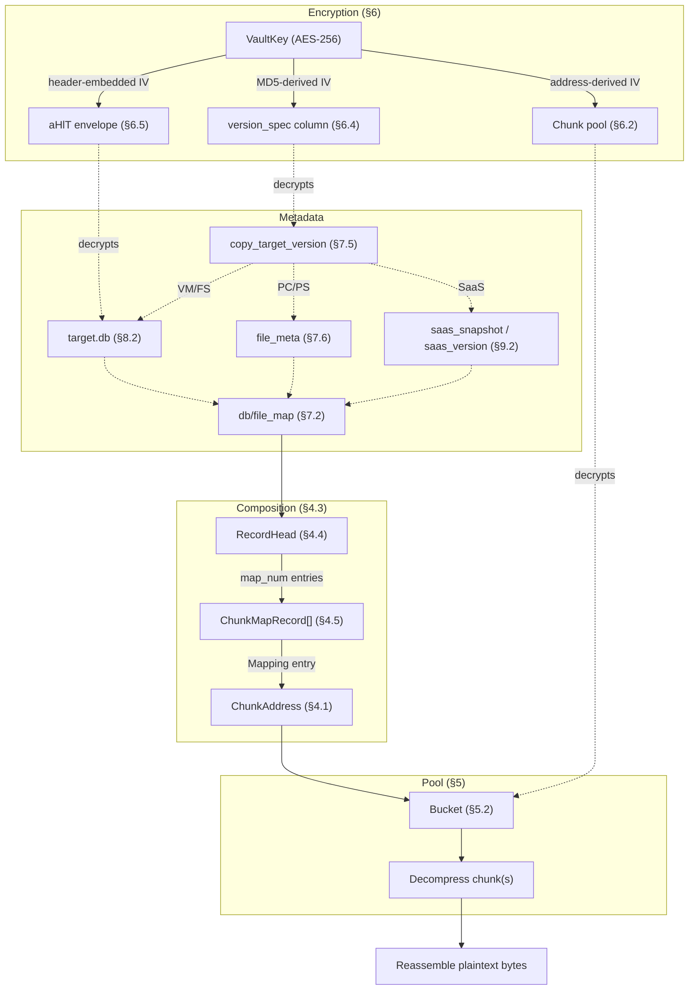

# FORMAT-SPEC

## §1. Scope and conventions

This document specifies the on-disk dedup repository format that Synology
ActiveProtect writes when it copies backups to an ActiveProtect Vault (APV)
or to object storage (S3 or Azure). It covers what is needed to open a
landed repository and recover the plaintext of any backed-up file offline.
It describes bytes only, not how any program reads them.

### §1.1 Conventions

- Every multi-byte integer is big-endian.
- A byte range `[a, b)` includes `a` and excludes `b`.
- CRC32 is the IEEE (zlib) CRC-32.
- A chunk is always 4096 bytes of plaintext.
- "Database" means a SQLite file. Database files have no extension.
- `<repoRoot>` is the repository root (§2.1). Paths are relative to it.
- A field marked *unused* carries no meaning for reading.

### §1.2 Glossary

| Term | Meaning | Section |
|---|---|---|
| Vault | A destination on a filesystem (local disk or SMB share). | §2.1 |
| Object storage | An S3 or Azure destination. | §2.1 |
| Copy | The job that lands backup versions from a source appliance in a destination. | — |
| Tiering | Another job that writes the same format; it differs only in the `saas_obj` path. | §9.1 |
| Connection | A source appliance connection the repository received data from. | §7.3 |
| Workload | One protected source: a VM, a PC, a physical server (PS), a file server (FS), or a SaaS user, site, group or team. | §7.4 |
| Version | One backup of a workload. | §7.5 |
| Stream | A dedup namespace with its own Pool and Composition directories. | §4.1 |
| Session | One contiguous write in a stream's composition space. | §4.3 |
| Record | One version of one file: a `RecordHead` and its chunk map. | §4.4 |
| Bucket | A `.buk` file holding up to 8192 chunks. Unrelated to an S3/Azure bucket. | §5 |
| Group | 1024 consecutive buckets sharing `.inf`/`.fgp` files. | §5.5 |
| VaultKey | The AES-256 data key. | §6.1 |

### §1.3 Overview

The main path from a version to its bytes (each workload's own steps are
in §8 and §9; §10 lists them in order):



---

## §2. Repository layout

### §2.1 Repository root

- **Vault**: the repository root is a directory one level below the shared
  folder the administrator chose (by convention `@ActiveProtectVault`; the
  name carries no meaning). It holds `repo_info`, `link.key` and
  `.fully_created` together. A shared folder holds one vault.
- **Object storage**: the storage root holds `@ActiveProtectData/` and,
  beside it, `@ActiveProtectKey/` with `userKey/` (§6.3) and `link/`
  (§7.3). Each `@ActiveProtectData/<repo-id>/` (a 12-character id) that
  holds both `db/` and `@data/` is a separate repository root. All of them
  share the one `@ActiveProtectKey/` tree. `repo_info` may exist only as
  `repo_info.<N>` here, so it does not mark a root.

### §2.2 Directory tree

```
<repoRoot>/
├── repo_info                  # §3.3
├── link.key                   # Vault only; magic lINk, no content needed
├── .fully_created             # Vault only; creation-complete marker
├── db/                        # databases, §7 (and §6.3 on Vault)
├── copy_meta_file/            # VM/PC/PS/FS version metadata, §8.1
├── saas/                      # SaaS stream databases, §9.2
├── repo_transactions/         # object storage only, §2.4
├── suppl_transaction_ids/     # object storage only, §2.4
└── @data/
    ├── Pool/                  # buckets and group files, §5
    ├── Composition/           # composition sessions, §4.3
    └── repo_transaction       # Vault only; not needed for reading
```

`db/` holds more databases than this document covers (copy tracking,
agent connections); none is needed for reading.

### §2.3 Sequence suffixes

A file with one current generation may land under its logical name with a
`.` and a decimal number appended, for example `1234.buk.7`. Among the
files whose name, after removing one trailing `.<digits>`, equals the
logical name, the one with the largest number is current. An unsuffixed
file is current only when no suffixed one exists.

The rule applies to bucket files, composition sub-files, group `.inf` and
`.fgp` files, and on a Vault also to `repo_info` and `db/<name>`. On
object storage, `repo_info` and `db/<name>` follow §2.4 instead, and the
SaaS stream databases follow §9.2. `db/vault_encryption_key` (§6.3) is
never suffixed.

On a Vault, bucket files always carry a suffix; composition sub-files
carry one only when the repository has WORM protection.

### §2.4 Generation selection

On object storage, `repo_info` and every `db/<name>` land as numbered
copies `<name>.<N>`. Old copies are not removed, and a copy can land before
the transaction that refers to it commits, so the largest suffix is not
necessarily current. The current copy is chosen as follows:

1. **Committed transaction id**: read the `repo_transaction` file (§3.4)
   with the largest suffix in `repo_transactions/`. Its `transaction_id`
   field is the id. The file's own suffix is not used.
2. **`repo_info` and ordinary databases** (including `file_map`): the
   largest `<N>` strictly less than the committed transaction id.
3. **Supplemental databases**: `agent_connection`, `connection_config`,
   `copy_file`, `copy_source_version`, `copy_target_version`,
   `copy_target_version_meta`, `copy_target_file`, `file_meta` and
   `workload_config` use the largest `<N>` for which an empty marker object
   `suppl_transaction_ids/<N>` exists. This numbering is unrelated to the
   transaction id.

The bare `<name>` is used only when no `<name>.<N>` exists. If numbered
copies exist but none qualifies, the database is missing.

`copy_target_file` has no file of its own: its table is inside the
`copy_target_version` database.

---

## §3. Common structures

### §3.1 Header shell

Every binary file type except `.fgp` and the composition record starts
with a 64-byte header:

| Offset | Size | Field |
|---|---|---|
| 0 | 4 | magic (ASCII) |
| 4 | 2 | major version |
| 6 | 2 | minor version |
| 8 | 52 | type-specific fields |
| 60 | 4 | CRC32 of `[0, 60)` |

The minor version carries no meaning. The major version is limited only
for buckets (at most 3, §5.1) and composition sub-files (exactly 1, §4.3).

| Magic | File |
|---|---|
| `bFiL` | Bucket (`.buk`), §5.1 |
| `GMet` | Group info (`.inf`), §5.5 |
| `bRfC` | Group reference counts (`.ref`); not needed for reading |
| `RpiF` | `repo_info`, §3.3 |
| `rPTs` | `repo_transaction`, §3.4 |
| `cMpS` | Composition sub-file 0, §4.3 |
| `aHlT` | Encrypted file envelope, §6.5 |
| `lINk` | `link.key`; not needed for reading |

### §3.2 Redundancy blob

A Redundancy blob protects a byte array (`data`) against one damaged
region. It splits `data` into windows of `coverage` bytes:

| Offset | Size | Field |
|---|---|---|
| 0 | 2 | magic `"RD"` |
| 2 | 2 | version, `0` |
| 4 | 4 | `coverage` |
| 8 | 8 | `data_size`, the length of `data` |
| 16 | `4 × ceil(data_size / coverage)` | `step_crc[i]`: CRC32 of `data[0, min((i+1)·coverage, data_size))` |
| … | `min(data_size, 2·coverage)` | parity: XOR of the even windows (`coverage` bytes), then XOR of the odd windows |

Its size is

```
redundancy_size(data_size, coverage) =
    16 + 4·ceil(data_size / coverage) + min(data_size, 2·coverage)
```

The cumulative CRCs locate the first damaged window. The parity rebuilds
it and the window after it: a damaged window equals its parity half XOR
every other window of the same parity. A short final window uses the
leading bytes of its parity half.

Buckets use it with coverage 256 (§5.2), composition records with
coverage 8192 (§4.4).

### §3.3 `repo_info`

A header shell (§3.1) with magic `RpiF`, followed by a JSON object at
`[64, 64 + data_size)`. Type-specific fields:

| Offset | Size | Field |
|---|---|---|
| 8 | 4 | `json_crc`: CRC32 of the JSON payload |
| 12 | 8 | `data_size`: length of the JSON payload |
| 20 | 16 | `uuid`: the repository UUID, as ASCII text |
| 36 | 24 | *unused* |

The payload holds `repo_type`, `repo_flag`, `is_global_dedup_supported`,
`is_worm_supported` and `storage_algorithm` (`compress_algorithm`,
`encrypt_algorithm`). None of them is needed for reading;
`encrypt_algorithm` does not tell whether data is encrypted (§6.1).

### §3.4 `repo_transaction`

`repo_transactions/repo_transaction.<N>` has the same layout as
`repo_info` (§3.3), with magic `rPTs`. Its JSON payload
holds `transaction_id`, and also `session_id` and `compact_id`. Each is a
JSON integer or a decimal string.

---

## §4. Composition

### §4.1 ChunkAddress

A 64-bit value that names one stored chunk:

```
bit  63........56  55..................16  15........0
    | streamID(8) |     bucketID(40)      | chunkIdx(16) |
```

- `streamID`: the dedup stream. A small integer, unrelated to any UUID.
- `bucketID`: the bucket in that stream's Pool.
- `chunkIdx`: the chunk's slot in the bucket, below 8192 (2¹³).

Advancing an address by `k` chunks carries into `bucketID` at 8192, not
at the field's 16-bit width: chunk 8191 of bucket `b` is followed by
chunk 0 of bucket `b + 1`.

### §4.2 Path layering

Pool and Composition paths nest a numeric id under ancestor directories
named `id >> 10`, `id >> 20`, `id >> 30`, …, outermost first, stopping
before the shift that gives 0. The leaf always carries the full decimal
id. An id below 1024 has no ancestor directory.

```
@data/Pool/<streamID>/[<id>>>30/][<id>>>20/][<id>>>10/]<bucketID>.buk
```

A group (§5.5) is named by its first bucket id, `bucketID` with its low
10 bits cleared, and its files use the same scheme.

### §4.3 Composition sessions

A stream's file content is described by composition records, stored in
sessions:

- **`streamID`**: the stream, the same as in every `ChunkAddress` the
  records refer to.
- **`sessionID`** (64-bit): one contiguous write, normally one backup run.
- **`subID`** (64-bit): a session's byte space is split into 16 MiB
  sub-files.

```
@data/Composition/<streamID>/[sessionID layers/]<sessionID>.com/[subID layers/]c<subID>
```

The §4.2 layering applies to `sessionID` and to `subID` separately. A
session offset maps to a sub-file as

```
subID                 = offset >> 24
offset_within_subfile = offset & (2^24 - 1)
```

and data that crosses a 16 MiB boundary continues at the start of the next
sub-file.

Sub-file 0 starts with a header shell (§3.1): magic `cMpS`, major version
1, and `subFileSize` (u32 at offset 8) equal to 16 MiB. The header is part
of the session's byte space, so no record starts below offset 64.

### §4.4 RecordHead

One version of one file is a record at session offset `headOff`, which is
`db/file_map.comp_offset` (§7.2). It starts with a 32-byte head:

| Offset | Size | Field | Meaning |
|---|---|---|---|
| 0 | 2 | magic | ASCII `"Mu"` |
| 2 | 2 | `status` | `0` Complete, `1` Interrupted; any other value is corruption |
| 4 | 2 | *unused* | |
| 6 | 8 | `map_num` | Number of `ChunkMapRecord` entries |
| 14 | 4 | `map_crc` | CRC32 of the whole `ChunkMapRecord` array |
| 18 | 2 | `mode` | Bit `0x0001`: a Redundancy blob follows. A record without this bit is outside this document. |
| 20 | 4 | `attr_leng` | Length of the attribute JSON |
| 24 | 4 | `attr_crc` | CRC32 of the attribute JSON |
| 28 | 4 | `head_crc` | CRC32 of `[0, 28)` |

The record continues with:

1. the `ChunkMapRecord` array, `map_num × 20` bytes (§4.5);
2. the attribute JSON, `attr_leng` bytes (not needed for reading);
3. a Redundancy blob (§3.2) over the array, coverage 8192.

Records are packed back to back, so the next record starts at

```
headOff + 32 + map_num·20 + attr_leng + redundancy_size(map_num·20, 8192)
```

The head is written last. A record that a committed `file_map` row points
to always has a valid head.

### §4.5 ChunkMapRecord

Each 20-byte entry describes one range of the file. Bytes `[0, 8)` are a
64-bit word:

| Bits | Field |
|---|---|
| 63–61 | Zero |
| 60 | INHERIT (§4.6) |
| 59–56 | Type: `0` Mapping, `1` Zero; any other value is corruption |
| 55–0 | `fileChunkIdx`: the range's file offset in chunks (`file_offset = fileChunkIdx × 4096`) |

The other 12 bytes depend on the type:

- **Mapping**: `[8, 16)` is the base `ChunkAddress` (§4.1). `[16, 20)` is
  `template << 16 | repeat`, two 16-bit counts. The range is `template`
  consecutive chunks from the base address, repeated `1 + repeat` times;
  each repetition starts again at the base address. Its length is
  `template × (1 + repeat) × 4096` bytes.
- **Zero**: `[8, 16)` is unused. `[16, 20)` is a 32-bit chunk count. The
  range reads as zeros and uses no Pool storage. Its length is
  `count × 4096` bytes.

Entries are in file-offset order. An entry of length 0 describes nothing.

### §4.6 Holes, Zero and INHERIT

Entries may leave gaps before the first entry, between entries, or after
the last. A gap is a **Hole**: it reads as zeros, like a Zero entry, but
has no entry.

A record does not store the file's byte length. The length is in the
workload metadata (§7.6, §8, §9); the range from the last entry to that
length is a Hole, and the last chunk is cut at that length.

Each record describes its version's whole content. INHERIT marks an entry
whose chunks are unchanged from an earlier version, but the entry still
holds its own addresses: no earlier record is needed to read it.

---

## §5. Pool

### §5.1 Bucket header

A bucket opens with a header shell (§3.1), magic `bFiL`, major version at
most 3. Type-specific fields:

| Offset | Size | Field |
|---|---|---|
| 8 | 4 | `mode` (bit set, below) |
| 12 | 4 | `chunk_num`: number of chunk slots |
| 16 | 4 | `chunk_size_crc`: CRC32 of the packed SizeStore bytes (§5.3) |
| 20 | 9 | *unused* |
| 29 | 4 | `crcOfChunkCrc`: CRC32 of the ChunkCrcStore (§5.4) |
| 33 | 27 | *unused* |

`mode` bits:

| Bit | Name | Meaning |
|---|---|---|
| `0x01` | COMPRESS | The compressed layout (§5.2). |
| `0x02` | CHUNK_CRC | A ChunkCrcStore is present (§5.4). |
| `0x80` | VAULT_ENCRYPT | Chunks are encrypted with the VaultKey (§6.2). |

Bits `0x04` (bucket parity), `0x08` (a key scheme other than the
VaultKey), `0x10` (locality placement), `0x20` (extent parity) and `0x40`
(in-place parity) are reserved; writers do not set them. `mode` is `0x03`
for a plaintext bucket and `0x83` for an encrypted one.

Each bucket's own VAULT_ENCRYPT bit says whether its chunks are encrypted.

### §5.2 Bucket layout

With COMPRESS set:

```
[0, 64)              header
[64, 16384)          SizeStore (§5.3), zero-padded
[16384, 16384+T)     chunk data, packed (T = sum of every chunk's stored length)
[16384+T, +4·n)      ChunkCrcStore (§5.4), n = number of non-empty chunks
[..., end)           Redundancy blob (§3.2) over the packed SizeStore, coverage 256
```

The file's size is therefore

```
16384 + T + 4·n + redundancy_size(ceil(chunk_num·15/8), 256)
```

With COMPRESS clear, chunk `i` is 4096 plaintext bytes at
`4096 + 4096·i`, and there is no SizeStore. This document does not cover
that layout's trailer.

### §5.3 SizeStore

One 15-bit entry per chunk, `type (3 bits) | size (12 bits)`, packed
bit-contiguously, most significant bit first. The packed length is
`ceil(chunk_num × 15 / 8)` bytes; `chunk_size_crc` covers these bytes
only, not the padding.

| `type` | Name | Stored bytes | Stored length |
|---|---|---|---|
| 0 | None | plaintext | 4096 (`size` ignored) |
| 1 | LZ4 | one LZ4 block (no frame, no size prefix) | `size` |
| 2 | ZSTD | one zstd frame | `size` |
| 4 | Compacted | nothing; the chunk was reclaimed and cannot be read | 0 |

Any other `type`, 3 included, is corruption. Chunk `i` starts at 16384
plus the stored lengths of chunks `0..i`. Each chunk has its own type, so
one bucket can mix LZ4 and ZSTD. A decompressed chunk is exactly 4096
bytes.

### §5.4 ChunkCrcStore

One CRC32 per non-empty chunk (stored length above 0, so not Compacted),
in chunk order, over the chunk's stored bytes (compressed, and encrypted if
the bucket is). `crcOfChunkCrc` in the header covers these `4 × n` bytes.
Neither CRC is needed to read content.

### §5.5 Sidecar files

Each group of 1024 buckets (§4.2) has two kinds of sidecar file, both
named by the group's first bucket id and both taking a sequence suffix
(§2.3):

- **`<group>.inf`** (magic `GMet`, a multiple of 4096 bytes): an allocation
  table at `[12288, 20480)` with one 8-byte entry per bucket of the group,
  in bucket order. The entry's first 4 bytes are
  `offset4K (17 bits) | recNum (15 bits)`; the other 4 are unused.
  `offset4K × 4096` is where the bucket's first fingerprint sits in the
  group's fingerprint data, and `recNum` is how many it has.
- **`<group>_<segment>.fgp`** (no header): the group's fingerprint data,
  split into 4 MiB (2²² bytes) segment files. Each fingerprint is the
  32-byte SHA-256 of a chunk's 4096 plaintext bytes. Chunk slot `i` of a
  bucket (`i < recNum`; Compacted slots keep their place) is at
  `fp_off = offset4K·4096 + 32·i`, in segment `fp_off >> 22` at offset
  `fp_off & (2²² − 1)`. One bucket's fingerprints can span two segments.

A fingerprint checks a decoded chunk end to end, and so also checks a
VaultKey (§6.2).

---

## §6. Encryption

### §6.1 Keys

| Name | Size | Role |
|---|---|---|
| VaultKey | 32 bytes | The data key: the AES-256 key for chunks (§6.2), `version_spec` (§6.4) and `aHlT` files (§6.5). |
| UserKey | 32 bytes | The key-encryption key: wraps the VaultKey with AES-256-GCM (§6.3). |
| UserKeyID | 12 ASCII characters | Names the UserKey; also the GCM nonce. |

An administrator's key string is `"<UserKeyID>@<base64(UserKey)>"`; split
it at its last `@`. A UserKeyID never contains `/` or `\`.

The UserKeyID `NoEncryption` marks a repository without encryption: it has
no VaultKey, and chunks, `version_spec` and `copy_meta_file/` files are
plaintext. Encryption is fixed when the connection is first set up.

Composition records, `.inf`/`.fgp`, `repo_info` and every database under
`db/` and `saas/` are always plaintext (apart from the `version_spec`
column).

All three VaultKey uses are AES-256-CTR: the 16-byte IV is the initial
counter block, incremented as one 128-bit big-endian integer. They differ
only in the IV.

### §6.2 Chunk pool encryption

In a VAULT_ENCRYPT bucket (§5.1), each chunk's stored bytes are encrypted
on their own, after compression: decrypt first, then decompress (§5.3). The
IV is the chunk's 64-bit `ChunkAddress` (§4.1), big-endian, twice:

```
iv[0:8]  = big_endian(chunk_address)
iv[8:16] = big_endian(chunk_address)
```

A wrong key can still produce a chunk that decompresses to 4096 bytes: an
LZ4 block has no magic or checksum (a zstd frame starts with
`28 B5 2F FD`). Only the chunk's fingerprint (§5.5) proves the plaintext
correct.

### §6.3 VaultKey custody

The VaultKey is stored wrapped with AES-256-GCM: key = UserKey, nonce =
the 12 ASCII bytes of the UserKeyID, no additional data. The wrapped form
is 48 bytes (32-byte ciphertext, then the 16-byte tag), stored as base64
that may contain whitespace. A tag check that fails means the key string
is wrong.

- **Object storage**: the object `@ActiveProtectKey/userKey/<UserKeyID>`
  holds the base64 (64 characters). An object
  `@ActiveProtectKey/userKey/init@<UserKeyID>` may also exist; it is not
  needed. A repository without encryption has a
  `@ActiveProtectKey/userKey/NoEncryption` object instead. Every
  repository root under the storage root shares these keys.
- **Vault**: the database `db/vault_encryption_key` (never suffixed),
  table `vault_encryption_key` with columns `user_key_uuid` (the
  UserKeyID, unique), `encrypted_data_key` (the base64) and `crtime`. A
  repository without encryption has one row with `user_key_uuid =
  "NoEncryption"` and an empty `encrypted_data_key`.

A key change replaces only the UserKey. The VaultKey never changes, so
several UserKeyIDs can coexist, each wrapping the same VaultKey.

The repository is unencrypted exactly when its key record says
`NoEncryption` alone: on a Vault, the `user_key_uuid` of the last-inserted
row; on object storage, the set of object names under
`@ActiveProtectKey/userKey/` with any `init@` prefix removed.

### §6.4 version_spec encryption

In an encrypted repository, the `version_spec` column of
`copy_target_version` (§7.5) is standard base64 of AES-256-CTR ciphertext
over the whole JSON text; otherwise it is the plain JSON. Nothing in the
column says which.

The IV is the first 16 characters, as ASCII bytes, of the lowercase hex
MD5 of the row's `version_uid`: `hex(MD5(version_uid))[0:16]`, not the
raw digest. The plaintext is UTF-8 JSON.

### §6.5 File-level encryption

In an encrypted repository, every file under `copy_meta_file/` (§8.1) is
wrapped in one `aHlT` envelope, whatever the file is (a database, a zstd
frame, JSON). A file that does not start with `aHlT` is plaintext.

The envelope is a header shell (§3.1) with magic `aHlT`, major and minor
version 0, and a random 16-byte IV at `[8, 24)`; the rest of the
type-specific bytes are unused. Bytes 64 to the end are the file's
ciphertext, one AES-256-CTR stream under the VaultKey and this IV.

---

## §7. Catalog databases

### §7.1 Database files

Any database (under `db/`, `copy_meta_file/` or `saas/`) may have
`-wal`, `-shm` or `-journal` siblings. A non-empty `-wal` holds committed
pages not yet in the main file and must be applied; a zero-length one
holds nothing. Under `copy_meta_file/`, each sibling has its own `aHlT`
envelope (§6.5).

### §7.2 `db/file_map`

The entry point to file content. Table `file_map`, one row per path:

| Column | Meaning |
|---|---|
| `path` | TEXT primary key: the lookup key (§8, §9). |
| `stream_id`, `session_id`, `comp_offset` | The record's address: stream and session (§4.3) and `headOff` (§4.4). A unique index covers the triple. |
| `block` | Chunk count of the file; not needed for reading. |
| `crtime`, `mtime` | Not needed for reading. |
| `status` | `0` Initialized, `1` Written, `2` Complete, `3` Compacted, `4` Corrupted, `5` Tainted. Only a Complete row can be read in full. |

A new version of a path overwrites its row, so `file_map` holds only the
latest record of each path. An older record stays in place, reachable
through its own triple, until garbage collection reclaims it.

### §7.3 Connections

`db/connection_config`, table `connection_config`, has one row per
connection: `connection_config_id` (an integer local to this repository)
and `connection_id` (the source's own id).

A connection's display name is in its link name, stored:

- **Vault**: `db/vault_link_key`, table `vault_link_key`, column `key`,
  one row per name.
- **Object storage**: as the entry names under `@ActiveProtectKey/link/`;
  the entries' contents are not needed.

A link name has the form `<connection_id>_<other>_<name>`. The display
name is everything after the second `_` (it may itself contain `_`). A
connection without a link name has none.

### §7.4 `workload_config`

`db/workload_config`, one row per workload:

| Column | Meaning |
|---|---|
| `workload_id` | Integer key. |
| `workload_uid` | The workload's UUID. |
| `workload_type` | `VM`, `PC`, `PS` or `FS` (device workloads, §8); `M365` or `GW` (Google Workspace, written GWS here) for SaaS (§9). |
| `workload_spec` | JSON, below. |

`workload_spec` holds `namespace` (a server bookkeeping id), `spec` and
`status`:

| Field | Present for | Meaning |
|---|---|---|
| `spec.workload_name` | device workloads | The workload's name. |
| `spec.config_vm.os_name`, `spec.config_vm.hypervisor_name` | VM | Descriptive. |
| `spec.config_fs.os_name` | FS | Descriptive. |
| `spec.workload_type` | SaaS | The application, below. |
| `spec.tenant_id` | M365 | The tenant GUID (M365 stores no plain domain). |
| `spec.domain` | GWS | The domain. |
| `status.entity_meta.spec` | SaaS | Exactly one of `user_info` (`{name, email}`), `site_info` (`{site_name}`), `group_info` (`{display_name, mail}`), `team_drive_info` (`{name}`) or `team_info` (`{name}`): the user, site, group or team. |

A SaaS application (`spec.workload_type`) is one of `MAIL`, `CONTACT`,
`CALENDAR`, `DRIVE`, `USER_DRIVE`, `SITE`, `USER_EXCHANGE`, `TEAMS`,
`USER_CHAT`, `TEAM_DRIVE` or `GROUP_EXCHANGE`. Each is one service except
`USER_EXCHANGE` (Mail, archive Mail, Contact, Calendar) and
`GROUP_EXCHANGE` (Mail, Contact, Calendar), which hold several services in
one version (§9.4). `TEAM_DRIVE` and `GROUP_EXCHANGE` are the shared forms
of `USER_DRIVE` and `USER_EXCHANGE`, with the same schema. GWS has no
`GROUP_EXCHANGE`.

### §7.5 `copy_target_version`

`db/copy_target_version`, one row per landed version:

| Column | Meaning |
|---|---|
| `version_id` | Integer key. |
| `version_uid` | Names the version's metadata directory (§8.1); the `version_spec` IV input (§6.4). |
| `workload_id` | The workload (§7.4). |
| `connection_config_id` | The connection (§7.3). |
| `target_type` | As `workload_config.workload_type`. |
| `target_id` | The source workload's UUID (§8.3, §8.4). |
| `saas_stream_uuid`, `saas_snapshot_uuid`, `saas_version_id` | SaaS only (§9.1, §9.2). |
| `deleted` | Non-zero: the version is deleted. |
| `version_spec` | JSON, encrypted per §6.4. |

`version_spec.status` holds:

| Field | Meaning |
|---|---|
| `status` | `COMPLETED`, `PARTIAL` and `CANCELED` mean the version landed data (a canceled job may have copied data before it stopped). `BACKING_UP`, `FAILED`, `PAUSED`, `DELETING`, `DELETE_FAILED`, `CLONING`, `CMS_PROCESSING` and `NONE` mean it did not. |
| `start_time`, `end_time` | Epoch seconds, as a decimal string (for example `"1786024626"`) or a number. `0` means unset. When `start_time` is unset, `end_time` is the version's time. |
| `additional_meta` | SaaS only: a JSON object encoded as a JSON string. |

`additional_meta` holds:

- `object_db_id`: the address of the version's `object_table` (§9.3).
- `db_object_ids.db_objects`: an array of `{name, object_id}` pairs, one
  per service database (§9.4).

### §7.6 Version file tables

These tables link a device version to its metadata and its files:

- **`db/copy_target_version_meta`**: one row per version whose metadata
  directory landed. `version_uid` is the key; `target_meta_path` names the
  directory (§8.1); `meta_filenames` is a JSON array of every landed file
  in it (database siblings, §7.1, excluded); `status` is `0` (Writing) or
  `1` (Complete).
- **`copy_target_file`** (inside the `copy_target_version` database,
  §2.4): rows `(version_id, fid)` listing the files of a version.
- **`db/file_meta`**: rows `(fid, path, file_size)`. `path` is the
  `db/file_map` key (§7.2); `file_size` is the file's length in bytes
  (§4.6).

`copy_target_file` → `file_meta` → `file_map` is the only path to a PC/PS
version's disks (§8.5). A `fid` absent from `file_meta`, or a `path`
absent from `file_map`, is a missing file.

---

## §8. Device workloads

### §8.1 Metadata directory

Each landed VM, PC, PS or FS version has a directory
`copy_meta_file/<dir>/`, where `<dir>` is the last component of
`copy_target_version_meta.target_meta_path` (§7.6). That is the
`version_uid` on object storage, and `<workloadType>_<version_uid>` on a
Vault (where `target_meta_path` is an absolute path on the appliance).

- **VM and FS**: `target.db` (§8.2) and one version folder,
  `ActiveBackup_<timestamp>[_<suffix>]`. FS appends its version UUID; VM
  appends `_1`, `_2`, … only to separate two versions in the same second.
  The folder holds `rebuild_target.db` (§8.2) and workload files: VM
  configuration and change-tracking files, FS's `version.db.zst` (§8.4).
- **PC and PS**: only `snapshot_info.json`. The disks are found through
  `db/` (§7.6, §8.5).

Every file here may be `aHlT`-wrapped (§6.5).

### §8.2 `target.db` schema

`target.db` and `rebuild_target.db` share this schema and each hold one
version's rows. `rebuild_target.db` is written on the source appliance
before the Copy job, so its dedup objects have an empty `src_file_path`;
only `target.db` gives `src_file_path`. `rebuild_target.db` has no
siblings (§7.1).

**`version_table`**, one row:

| Column | Meaning |
|---|---|
| `id` | Row key; not a join key. |
| `version_id` | The source appliance's version id; the join key. |
| `version_uuid` | Unique. |
| `folder_name` | The version folder's name (§8.1). |
| `status`, `verify_status`, `used_size`, `time_start`, `time_end`, `locked`, `crypto_key_id`, `is_snapshot`, `full_backup`, `plan_scope`, `enable_*_truncate_log`, `mssql_info`, `oracle_info`, `version_type` | Not needed for reading. |

**`device_table`**, one row per device:

| Column | Meaning |
|---|---|
| `device_id` | Row key; not a join key. |
| `config_device_id` | The join key to `object_table`. |
| `host_name`, `os_name`, `version_id`, `device_uuid`, `cpu_number`, `memory_size`, `is_system_mbr`, `mount_map`, `other_spec`, `version_uuid` | Descriptive. |

**`object_table`**, one row per object (disk image, configuration file,
change-tracking file):

| Column | Meaning |
|---|---|
| `object_id` | Primary key. |
| `version_id`, `config_device_id` | Join keys. |
| `dedup_object` | Non-zero: the content is in the dedup store (§8.3). Zero: an ordinary file under the metadata directory. |
| `file_path` | For an ordinary file, its path relative to `copy_meta_file/<dir>/` (the first component is the version's `folder_name`). For a dedup object, only a label. |
| `src_file_path` | For a dedup object, its `db/file_map` key (§8.3). |
| `file_size` | The object's length in bytes. |
| `temp_postfix` | Non-empty: the write was interrupted; the row has no content. |
| `data_format` | For a dedup object, `1` is a plain image (one record). Any other value is an incremental chain this document does not cover. |
| `parent_object_id` | `0`; carries no meaning for reading. |
| `fs_type`, `file_mtime`, `block_size`, `crc32`, `object_uuid`, `object_meta`, `version_uuid` | Not needed to read one object (`object_uuid` links the disks of one VM). |

**`info_table`**: key/value pairs, including `create_time` and
`db_version` (the schema level).

A version's objects are the `object_table` rows with its
`version_table.version_id` and a device's `config_device_id`.

### §8.3 VM

A VM's disks are dedup objects of `target.db` (§8.2). A disk's
`src_file_path` is a path relative to the source appliance's repository
root, `VM-<target_id>/<folder_name>/<hostName>/<diskFile>`, where
`target_id` is from `copy_target_version`. In the destination it has no
meaning except as the disk's `db/file_map` key (§7.2).

### §8.4 FS

An FS version is one virtual image, `<target_id>/<version_id>/dedup.img`,
whose `db/file_map` key is that path (`target_id` from
`copy_target_version`, `version_id` from `target.db`'s `version_table`).
Each file of the version is the byte range
`[content_dedup_id, content_dedup_id + file_size)` of the image.
`target.db` registers `version.db.zst` as one ordinary object.

The image's address space grows across all versions of the workload and
is never reused: a deleted file becomes a Hole (§4.6) in later versions,
and its offset is never given to another file.

**`entry_table`** is in `version.db.zst` in the version folder: a zstd
frame holding a database, listed in `meta_filenames` (§7.6) and
`aHlT`-wrapped when encrypted.

| Column | Meaning |
|---|---|
| `basename` | The entry's name. |
| `dirname` | The parent's absolute path. `/` has no row; its children have `dirname = "/"`. A child's `dirname` is its parent's `dirname` and `basename` joined with `/`. |
| `file_size`, `file_mtime` | Length in bytes, modification time. |
| `file_type` | `1` file, `2` directory. |
| `content_dedup_id` | Byte offset into `dedup.img`, as decimal text, 4 KiB-aligned; empty for a directory. |
| `xattr` | ACLs and extended attributes. |
| `keep_flag` | Not needed for reading. |

### §8.5 PC/PS

A PC or PS version's disks are the files `copy_target_file` lists
(§7.6). The disk analyzer may split one physical disk into several
fragments. A fragment's `file_meta.path` is

```
0/<deviceUuid>/<sessionUuid>/D(<diskUuid>)[O(<offset>)][V(<volumeUuid>)]S(<diskIndex>)[_<seq>].img
```

- `D` and `S` identify the physical disk; all fragments with the same
  pair belong to it.
- `V` appears only on a fragment that covers a mounted volume.
- `_<seq>` (never `_0`) marks a continuation of the same region, written
  as a separate file during a long backup.

A disk that was not split is one file,
`0/<deviceUuid>/<sessionUuid>/<uuid>_<uuid>.img`.

Each fragment's record uses disk offsets: its entries (§4.5) lie at their
place on the whole disk. `O(...)` (absent on some fragments, and not
4 KiB-aligned) does not give the range, and `file_meta.file_size` is the
whole disk's capacity on every fragment. The disk is the union of its
fragments' entries over `[0, file_size)`; ranges no fragment covers are
zeros.

Adjacent fragments may overlap by up to one chunk and disagree there (one
has a Zero entry, the other data). The fragment with the higher first
offset is correct.

---

## §9. SaaS workloads

### §9.1 `saas_obj`

An M365 or GWS version is stored in one dedup file, `saas_obj`, whose
`db/file_map` key is

```
<streamUuid>/<connection>/<streamVersion>/saas_obj
```

- `<streamUuid>`: `copy_target_version.saas_stream_uuid`.
- `<connection>`: the `connection_config.connection_id` for Copy, or the
  numeric `connection_config_id` for Tiering (§7.3).
- `<streamVersion>`: a generation counter of the stream (§9.2).

Several consecutive versions can share one `saas_obj` before a new
generation starts. Only rows with `status = 2` (§7.2) hold a generation.

### §9.2 Stream generations

Two databases under `saas/<connection_config_id>/<streamUuid>/db/` map a
version to its `<streamVersion>`. Each may exist under its bare name and
as `.<N>` copies; here the bare name, when present, is the current one
(unlike §2.3). A zero-length bare file is a placeholder: the largest
`.<N>` copy is then current.

| Database | Table | Columns |
|---|---|---|
| `saas_snapshot` | `snapshot_info` | `snapshot_uuid` → `snapshot_id`; look up `copy_target_version.saas_snapshot_uuid`. |
| `saas_version` | `version_info` | `(snapshot_id, version_id)` → `stream_version`; `version_id` is `copy_target_version.saas_version_id`. |
| `saas_version` | `stream_info` | Row `id = 1`: `latest_complete_version`. |

`version_info.stream_version` is the generation the version was written
to. Garbage collection removes old generations (their `file_map` rows and
chunks). Each later generation contains everything an earlier one did, so
a version is also in every later generation up to
`stream_info.latest_complete_version`. Generations above that bound are
not committed.

### §9.3 `object_table`

Every SaaS object (a mail part, a metadata JSON, a file's content, a
service database) is a byte range of the version's `saas_obj`. The
`object_table` maps each `object_id` to it:

| Column | Meaning |
|---|---|
| `object_id` | The object's id. |
| `offset` | Byte offset in `saas_obj`. |
| `length` | Byte length. |

The `object_table` is itself a database stored as is (not in a zstd
frame) in `saas_obj`. Its address is
`additional_meta.object_db_id` (§7.5), `"<streamUuid>_<offset>_<length>"`
(split from the right). Each checkpoint writes a full new copy, so a
stream holds several copies until old ones are reclaimed; within one
sequence, the copy at the highest offset is the latest.

Without `additional_meta`, the copies can be found by scanning `saas_obj`
for the SQLite header (`SQLite format 3\0`): a database's length is its
page size (u16 at header offset 16) times its page count (u32 at offset
28).

### §9.4 Service databases

`additional_meta.db_object_ids.db_objects` (§7.5) names the object that
holds each service database. A service database is one zstd frame holding
a database.

| `db_objects` name | Table | Columns |
|---|---|---|
| `mail_db`, `group_mail_db`, `archive_mail_db` | `mail_table` | `mail_id`, `subject`, `meta_object_id`, `parent_folder_id`, `sender`, `remote_timestamp` |
| `mail_folder_db`, `group_mail_folder_db`, `archive_mail_folder_db` | `mail_folder_table` | `folder_id`, `folder_name`, `parent_folder_id`, `is_root` (`1` on the root) |
| `mail_label_db` | `mail_label_table` | `label_id`, `label_name` (GWS label definitions) |
| `mail_db` | `mail_label_table` | `mail_id`, `label_id` (GWS label membership) |
| `contact_db` | `contact_table` | `contact_id`, `first_name`, `last_name`, `meta_object_id`, `parent_folder_id`, `primary_email` |
| `contact_db` | `contact_group_table` | `contact_id`, `group_id` |
| `contact_folder_db` | `contact_folder_table` | `folder_id`, `folder_name` |
| `contact_group_db` | `group_table` | `group_id`, `group_name` |
| `calendar_db`, `group_calendar_db` | `calendar_table` | `calendar_id`, `calendar_name`; optional `timezone`, `calendar_type` (`1`: listed under other calendars, otherwise the user's own), `calendar_name_override` (shown instead of the name) |
| `calendar_event_db`, `group_calendar_event_db` | `calendar_event_table` | `event_id`, `calendar_id`, `summary`, `meta_object_id`; optional `event_start_time`, `event_end_time`, `recurrence_rule` (JSON with `pattern.type`) |
| `drive_db` | `item_table` | `item_id`, `name`, `size`, `mtime`, `meta_object_id`, `content_object_id`, `type` (`0` folder), `parent_folder_id`; optional `hash`, `etag`, `starred` |
| `drive_db` | `config_table` | `key`, `value`; key `root_folder_id` names the root folder |
| `site_list_db` | `list_version_table` | §9.9 |
| `site_item_db` | `item_version_table` | §9.9 |

Teams and Chat databases are found through an index (§9.10).

`meta_object_id` names an item's metadata JSON (§9.5);
`content_object_id` names its content.

### §9.5 Object kinds

| Kind | Encoding | Content |
|---|---|---|
| Service database | One zstd frame holding a database | §9.4; its table names identify the service. |
| Index | JSON object with a non-empty `db_objects` array, or `{"name": "db_infos_in_snapshot", "object_id": …}` | A list of `{name, object_id}` pairs (the `db_object_ids` shape, §7.5), or a pointer to one. |
| Metadata | Any other JSON object | Per-item metadata: Mail's `content_list` (§9.6), Contact and Calendar `client_metadata`, a Site item. |
| Mail skeleton | Raw MIME text | §9.6. |
| Content | A zstd frame, or raw bytes | A file's bytes (Drive, Site) or a mail part. |

### §9.6 Mail

- **M365**: a folder tree with one parent per folder (`mail_folder_table`),
  and a separate archive mailbox (`archive_mail_db`, same schema).
- **GWS**: no folders and no archive; mails carry labels, many to many
  (`mail_label_table` in two databases, §9.4).

A mail is a skeleton MIME tree plus extracted parts. Each extracted part
keeps its headers in the skeleton, has an empty body there, and gains an
`X-ABL-ID` header. The mail's metadata JSON has a `content_list` of
`{type, fragment_id, object_id}` entries; the entry with `type` 0 is the
skeleton, and every other entry is a part's body.

To rebuild the mail, walk the skeleton, descending into `multipart/*` and
`message/rfc822`. For each part whose `X-ABL-ID` equals a `fragment_id`,
insert that object's bytes as the body, encoded per the part's
`Content-Transfer-Encoding` (base64 or quoted-printable; any other value
means the bytes go in unchanged), and remove the `X-ABL-ID` header. Parts
match by id, not by position.

### §9.7 Contact

- **M365**: contacts sit in a folder tree (`contact_folder_table`). The
  metadata JSON has `version` `"1.0"`, and its `client_metadata` uses the
  Microsoft Graph `contact` field names (`givenName`, `surname`,
  `emailAddresses[].address`, `businessPhones[]`, `businessAddress.*`,
  `personalNotes`, …). There is no photo.
- **GWS**: a contact belongs to zero or more groups (`contact_group_table`
  and `group_table`, including the built-in `myContacts`). The metadata
  JSON has `version` `"2.0"` and uses the Google People API `Person`
  shape, with `photo_object_id`, `photo_size` and `photo_hash` when the
  contact has a photo.

### §9.8 Calendar

The event metadata JSON uses:

- **M365**: Microsoft Graph names: `iCalUId`, `subject`, organizer
  `{"emailAddress": {"address", …}}`, `dateTime` with a separate
  `timeZone`. An EWS form also exists: a `client_metadata` holding a
  `RawXML` key.
- **GWS**: Google Calendar names: `iCalUID`, `summary`, organizer
  `{"email", "displayName", …}`, `dateTime` with its UTC offset.

### §9.9 SharePoint Site

M365 only. A site is a set of lists. A list is an **ordinary list** (rows
of field values with attachments) or a **document library** (files and
folders), in a schema separate from Drive's.

| Table | Columns |
|---|---|
| `list_version_table` | `list_id`, `list_title`, `meta_object_id`, `list_type` (`1` document library), `root_folder_id`; optional `create_time` |
| `item_version_table` | `item_id`, `list_id`, `file_id`, `parent_folder_id`, `title`, `item_type` (`'FOLDER'` or `1` for a folder), `meta_object_id`, `url_path`; optional `value1`, `mtime` |

Each table holds one row per list or item, its latest state; earlier
states are in earlier versions' databases.

`meta_object_id` is the only link to an item's content. The item's
metadata JSON holds the content address itself, as Mail's does:
`content_list[0].object_id`. An item without a `content_list` (a row of an
ordinary list) has only the `values` object of its metadata. A
`file_object_id` column, where present, carries no meaning for reading.

### §9.10 Teams and Chat

M365 only. Teams holds channel messages; Chat holds one-to-one and group
chats. Their databases are found through an index:

1. The version's `db_objects` has an entry `db_infos_in_snapshot` naming
   an Index object (§9.5).
2. In that index, the first entry named `teams_channel_db` or `chat_db` is
   the **container**: a service database with `channel_info_table`
   (Teams) or `chat_info_table` (Chat).
3. Every other entry with a different `object_id` is one channel's or
   chat's message database, named by the channel or chat id.

| Table | In | Columns |
|---|---|---|
| `channel_info_table` | container | `channel_id`, `name`, `channel_type` (`standard`, `private` or `shared`), `create_time` |
| `chat_info_table` | container | `chat_id`, `topic`, `chat_type` (`0` one-on-one, `2` meeting) |
| `chat_members_table` | container | `chat_id`, `members` (JSON array of objects with `userId`, `userEmail`, `role`, `tenantId`, `visibleHistoryStartDateTime`, `membershipId`, `display_name`) |
| `msg_info_table` | message database | `msg_id`, `author`, `create_time`, `content_preview`, `metadata`, `is_sys_message`, `is_deleted`, `reply_to_id` |
| `sticker_info_table` | message database (optional) | `msg_id`, `url`, `base64_content` |

---

## §10. Restore procedure

Given a repository, a file to recover and, if the repository is
encrypted, the key string:

1. **Unwrap the VaultKey** (§6.3), if the repository is encrypted.
2. **Find the `db/file_map` key** and the file's length. Decrypt
   `copy_meta_file/` files that start with `aHlT` (§6.5) first.
   - VM: `target.db` → `object_table.src_file_path` and `file_size`
     (§8.2, §8.3); only for `data_format = 1`.
   - PC/PS: `copy_target_file` → `file_meta.path` and `file_size`
     (§7.6, §8.5).
   - FS: `entry_table` → a byte range of `dedup.img` (§8.4).
   - SaaS: service database → `object_id` → `object_table` → a byte range
     of `saas_obj` (§9.2–§9.4).
3. **Open `db/file_map`**: the current copy per §2.3 (Vault) or §2.4
   (object storage).
4. **Look up the row** by path (§7.2); continue only if `status = 2`.
5. **Read the record**: map `comp_offset` to a sub-file (§4.3), then read
   and check the `RecordHead` (§4.4) and the `map_num × 20`-byte
   `ChunkMapRecord` array (§4.5), continuing into the next sub-file when
   needed.
6. **Expand the entries**: chunk `k` of a Mapping entry
   (`0 ≤ k < template × (1 + repeat)`) is the base address advanced by
   `k mod template` (§4.1). Zero entries and Holes are zeros (§4.6).
7. **Read each chunk**: find its bucket (§4.2, §2.3) and its bytes through
   the SizeStore (§5.3). If the bucket has VAULT_ENCRYPT, decrypt with the
   address IV (§6.2). Decompress.
8. **Assemble** the chunks in file order, then cut or zero-extend to the
   length from step 2; for a sub-range, take
   `[offset, offset + length)` of the result.
